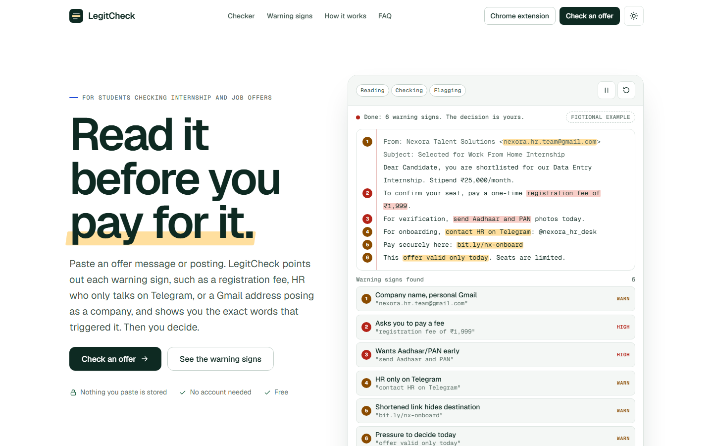
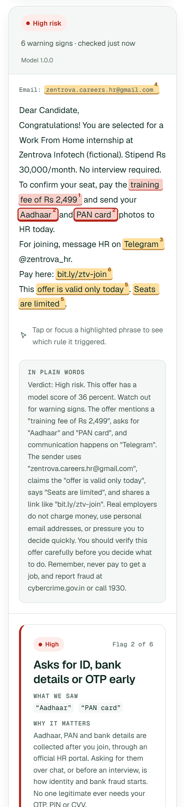
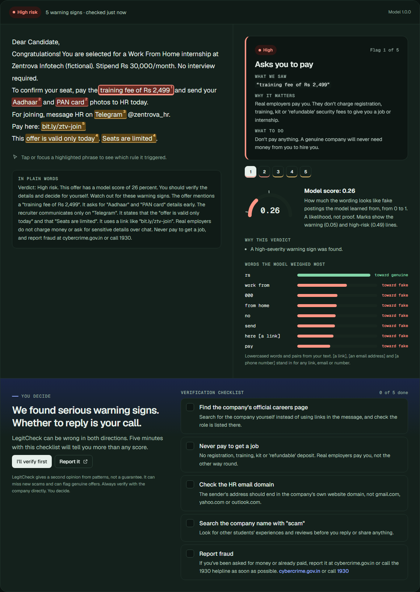
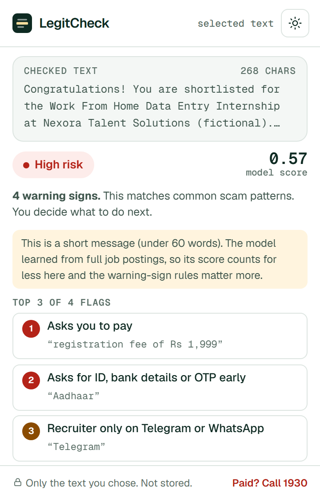
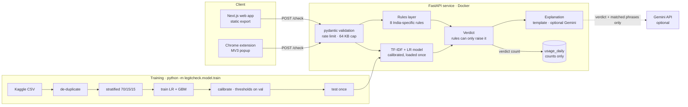

# LegitCheck

**Read it before you pay for it.** Paste an internship or job offer and LegitCheck flags the
warning signs, such as registration fees, Telegram-only HR, Gmail "recruiters" and early Aadhaar
requests. It shows the exact phrase behind each one and leaves the decision to you.

**Live demo:** [devkeerthi-code.github.io/legitcheck](https://devkeerthi-code.github.io/legitcheck/) (checks need the API below to be deployed) ·
**API docs:** TODO: add `https://<your-api>/docs` ·
**Model card:** [MODEL_CARD.md](MODEL_CARD.md) · **Evaluation:** [reports/evaluation.md](reports/evaluation.md)

## Who is this for and what problem does it solve?

Students in India, especially first-years and final-years looking for internships, are
targeted by fake offers. These ask for "registration" or "training" fees, refundable
"security deposits", move HR to Telegram or WhatsApp, use personal Gmail addresses posing as
companies, run "like videos and earn" task schemes, or ask for Aadhaar, PAN and bank details
before any interview. Many students only realise after they've paid.

LegitCheck gives a fast second opinion **before** you reply or pay. You paste the message on
the website, or right-click selected text with the Chrome extension. You get:

- a verdict: **Looks consistent with genuine postings**, **Has warning signs** or **High risk**.
  It never says "safe".
- every warning sign it found, with the exact phrase highlighted and a plain-language reason;
- a calibrated model score and the words that pushed it up or down;
- a "How to verify" checklist and the cybercrime.gov.in / **1930** helpline, every time.

## Screenshots

| Home (light) | High-risk verdict (mobile) |
|---|---|
|  |  |

| Verdict (dark) | Chrome extension |
|---|---|
|  |  |

## Features

- **Rules for Indian scam patterns.** Eight hand-written, unit-tested rules: payment or deposit
  requests (including UPI IDs and Hinglish "fees jama karna"), early ID/bank/OTP requests,
  task-based earning, messaging-app-only HR, personal email domains, unrealistic pay,
  pressure to decide fast, and shortened or brand-lookalike links (`infosys-careers.in`,
  `amaz0n-jobs.com`). Negations such as "we do not charge any fee" are handled.
- **ML model.** TF-IDF + logistic regression trained on 15,680 de-duplicated postings,
  calibrated, with thresholds chosen on validation. Test PR-AUC **0.879**; at the high-risk
  threshold it catches 79% of fake postings with 90% precision.
- **Explanations.** Exact per-word contributions from the linear model. Optional Gemini
  rewrites the explanation in plain English, Hindi, Tamil, Kannada or Telugu. It only sees the
  matched phrases, can't change the verdict, and the app works fully without it.
- **Web app.** Next.js + TypeScript + Tailwind, works at 360px, light by default with a dark
  toggle, every state designed (empty, loading, API asleep, rate-limited, errors).
- **Chrome extension (MV3).** Right-click "Check with LegitCheck" on selected text, or click the
  toolbar button to check the page. Minimal permissions and nothing stored.
- **Privacy.** Submitted text is never stored or logged. Usage is tracked as daily counts only
  (checks per verdict, first-time visitors), so "used by N people" is honest.

## Tech stack

| Layer | Tools |
|---|---|
| ML | Python 3.12, pandas, scikit-learn (TF-IDF, LogisticRegression, HistGradientBoosting, CalibratedClassifierCV), matplotlib |
| API | FastAPI, pydantic v2, slowapi (rate limiting), SQLAlchemy + SQLite/Postgres (usage counts), google-genai (optional) |
| Web | Next.js (App Router, static export), React, TypeScript (strict), Tailwind CSS v4, Geist, Vitest |
| Extension | Chrome Manifest V3, plain JS modules |
| Quality | pytest (120 tests), Vitest (25 tests), ruff, ESLint, GitHub Actions, Docker |

## Architecture



## The ML choices, and why

This is the part I expect to be asked about, so each choice has a reason and a number.

1. **De-duplicate before splitting.** 2,200 of the 17,880 postings are exact re-posts. Split
   first, and copies of one ad land in both training and test data, which tests memory rather
   than generalisation. I hash the normalised text and keep one copy per hash before splitting.
2. **Metrics for a rare class.** Only 4.5% of postings are fake, so predicting "genuine" every
   time is 95.5% accurate and useless. I report **PR-AUC** (0.879 vs a random 0.045), **recall at
   a fixed precision**, confusion matrices and the **Brier score**, never accuracy.
3. **Logistic regression beat gradient boosting.** TF-IDF + LR scored 0.878 PR-AUC on
   validation. Gradient boosting on about 20 engineered features scored 0.339 on text features
   and 0.567 with structured fields like "has company logo". The structured version can't be
   served anyway, because a pasted WhatsApp message has no logo or salary_range field. That
   train/serve gap is why the served model only uses text. LR also gives **exact** word
   contributions (coefficient × tf-idf), which is what the "top words" panel shows.
4. **Calibrate, then choose thresholds on validation.** `class_weight="balanced"` distorts
   probabilities, so I calibrate with Platt scaling over 5 folds. I used sigmoid rather than
   isotonic because isotonic overfits with about 500 positives. `ensemble=False` keeps one LR,
   so its coefficients still explain the score. The two thresholds come from validation:
   *high* = precision ≥ 90%, *warn* = recall ≥ 90%. The test set was scored **once**, at the end.
5. **Rules for what the data can't teach.** The dataset is mostly US postings from 2012-14, so
   Indian patterns barely appear. All 15 training postings that mention "Rs" are genuine, so the
   model even treats rupee amounts as slightly *genuine*. On a **synthetic** India holdout
   (written by me, never trained on), the model alone flags 7/14 scams; the rules flag 13/14.
6. **Short-message rule, found by testing.** The first version flagged 7 of 10 genuine short
   messages on the synthetic holdout. Short postings in training are often fake, so brevity
   alone raised the score. Under 60 words, the model's warning threshold no longer counts on its
   own: false alarms went from 7/10 to 0/10, and one scam with no rule-detectable sign was
   missed (13/14 instead of 14/14). Both versions are in [evaluation.md](reports/evaluation.md).

Details: [MODEL_CARD.md](MODEL_CARD.md) · [reports/evaluation.md](reports/evaluation.md) ·
[reports/error_analysis.md](reports/error_analysis.md)

### Results (test set, 2,352 postings, 106 fake)

| Model | PR-AUC | Recall @ 90% precision | Brier |
|---|---|---|---|
| **TF-IDF + logistic regression (served)** | **0.879** | **0.802** | **0.0116** |
| Gradient boosting, text features | 0.337 | 0.066 | 0.0392 |
| Gradient boosting, text + structured | 0.525 | 0.226 | 0.0342 |
| Average of LR and text GBM | 0.850 | 0.783 | 0.0179 |

At the saved thresholds: **high** catches 84 of 106 fakes with 9 false alarms among 2,246
genuine postings; **warn** catches 96 of 106 with 104 false alarms.

## Design decisions

| Decision | Alternatives considered | Trade-off |
|---|---|---|
| Rules + model, where rules can only *raise* the verdict | Model only; model with rule features | Transparent and fixes the India gap, but rules need maintenance and can be evaded by rewording. |
| No "safe" verdict; always show the checklist | Binary safe/scam | Less satisfying, but a wrong "safe" costs a student money and a false alarm costs a minute. |
| TF-IDF + LR served, not a transformer | Fine-tuned DistilBERT / IndicBERT | Lower ceiling, but 1.2 MB, under 10 ms per check on a free CPU, exact explanations, and easy to defend. A transformer would mostly learn the same 2012 US distribution. |
| Gemini only rewrites, and only sees matched phrases | LLM classifies the message | The verdict stays deterministic and testable, no full message leaves the server, and it works with no key. |
| Daily counts table, no text or IPs | Log requests for analytics | Can't debug individual mistakes, but there's nothing sensitive to leak. |
| Static-exported Next.js | Server-rendered Next.js | Deploys free on Vercel and GitHub Pages; the API does all the work anyway. |

## How to run locally

Needs Python 3.11+ and Node 20+.

```bash
# 1. Python env
python -m venv .venv
.venv\Scripts\activate          # macOS/Linux: source .venv/bin/activate
pip install -r requirements-dev.txt

# 2. Env vars (all optional for local use)
copy .env.example .env           # macOS/Linux: cp .env.example .env
copy web\.env.example web\.env.local

# 3. Install the web app and the root dev runner
npm install && npm --prefix web install

# 4. Run API (:8000) + web (:3000) together, with the venv active
npm run dev
```

Open http://127.0.0.1:3000 (if another app already uses `localhost:3000`, the IP form still
reaches LegitCheck). API docs are at http://127.0.0.1:8000/docs.

The trained model is committed (`models/legitcheck.joblib`), so the steps above work without
the dataset. To retrain or re-run the evaluation you need the data:

### Data

1. Download *Real / Fake Job Posting Prediction* from
   [Kaggle](https://www.kaggle.com/datasets/shivamb/real-or-fake-fake-jobposting-prediction)
   (free account). Licence: **CC0: Public Domain**. Original source: EMSCAD, University of the
   Aegean.
2. Unzip it so that `data/raw/**/fake_job_postings.csv` exists. `data/raw/` is git-ignored.
3. Run:

```bash
python -m legitcheck.model.train               # trains, picks thresholds on val, tests once
python -m legitcheck.model.evaluation_report   # renders reports/evaluation.md
python -m legitcheck.model.error_analysis      # validation mistakes -> reports/
python data/synthetic/build_india_offers.py    # rebuilds the SYNTHETIC India set
```

### Tests

```bash
pytest -rs          # 120 tests; the full metric-reproduction test runs when the CSV is present
ruff check . && ruff format --check .
npm --prefix web run lint && npm --prefix web test && npm --prefix web run build
```

### Load the Chrome extension (unpacked)

1. Open `chrome://extensions` and turn on **Developer mode** (top right).
2. Click **Load unpacked** and choose the `extension/` folder.
3. Pin LegitCheck from the puzzle-piece menu.
4. Select text on any page, right-click and choose **Check with LegitCheck**. Or click the
   toolbar icon to check the page's main text.
5. For a deployed API, edit `extension/config.js` (`API_URL`, `WEB_APP_URL`) and the matching
   `host_permissions` entry in `extension/manifest.json`, then click **Reload**. Put the
   extension's ID in the API's `EXTENSION_ID` env var to lock CORS to it.

## Deploy

All free tiers. Deploy the API first, then point the web app and extension at it.

### API on Render (Docker)

1. Push this repo to GitHub. On [render.com](https://render.com): **New > Web Service**, pick
   the repo, set *Runtime* to **Docker** and choose the Free instance type.
2. Environment variables:

| Variable | Required | Value |
|---|---|---|
| `ALLOWED_ORIGINS` | yes | `https://<your-app>.vercel.app,https://<you>.github.io` |
| `GEMINI_API_KEY` | no | From [aistudio.google.com/apikey](https://aistudio.google.com/apikey); enables translations |
| `GEMINI_MODEL` | no | Default `gemini-3.5-flash-lite` |
| `DATABASE_URL` | no | Neon Postgres URL (below). Without it, counts use SQLite and reset on redeploy |
| `EXTENSION_ID` | no | Your extension ID, to lock CORS to it |
| `RATE_LIMIT` | no | Default `20/minute;200/day` |

3. Deploy, then open `https://<service>.onrender.com/health`. Free instances sleep after 15
   minutes, so the first request can take about 30-50 s. The web app shows a "waking up" message.

**Alternative: Hugging Face Spaces.** Create a Space with the **Docker** SDK, push this repo to
it, and add `app_port: 7860` to the Space's README front matter. Add the same variables as
Space secrets.

### Usage counts on Neon (optional)

Create a free project at [neon.tech](https://neon.tech), copy the connection string into
`DATABASE_URL`. The `migrations/` SQL runs automatically at startup and is tracked in
`schema_migrations`.

### Web app on Vercel

**New Project**, import the repo, set **Root Directory** to `web`, and set the env var
`NEXT_PUBLIC_API_URL=https://<service>.onrender.com`. Deploy.

### Demo on GitHub Pages

Settings > Pages > Source: **GitHub Actions**. Add the repository variable `API_URL` (Settings >
Secrets and variables > Actions > Variables). The workflow `.github/workflows/pages.yml`
builds the site under `/<repo-name>` and publishes it on every push to `main`. Add the Pages URL
to `ALLOWED_ORIGINS`.

## Limitations and what breaks at scale

- **The model is not about India.** It learned from 2012-14, mostly US postings. Indian
  coverage comes from hand-written rules, which are evaluated only on 64 **synthetic** messages
  I wrote. That is a sanity check, not evidence of real-world accuracy.
- **Known biases.** Admin, receptionist, data-entry and oil-and-gas roles get more false
  alarms; very short texts score higher; rupee amounts score slightly *genuine*. See the
  [model card](MODEL_CARD.md).
- **Rules are evadable.** Writing "regn. amt" instead of "registration fee", or putting the
  request in an image, gets past them. Scam language changes faster than a regex list.
- **Rate limiting is per IP and in memory.** Behind several API instances each one counts
  separately (it needs Redis), and it trusts the first `X-Forwarded-For` hop, which a client
  can spoof if the API is exposed without a proxy. College networks share one IP, so
  20/minute can hit a whole hostel.
- **Free hosting.** Cold starts of 30-50 s. SQLite counts reset on each Render deploy unless
  `DATABASE_URL` is set. Gemini's free quota is small, and once it's used up explanations fall
  back to English templates.
- **At scale** I'd add a Redis rate limiter, a queue for Gemini calls with caching of rule-level
  explanations (not user text), batch scoring, and a feedback button that stores only the
  verdict and an opt-in label for retraining.

## What I learned

- **Leakage hides in the obvious place.** 12% of the dataset was duplicates. Splitting before
  de-duplicating would have quietly inflated every number.
- **Validation numbers aren't the product.** The model looked great on test (PR-AUC 0.879), but
  the first version flagged 7 of 10 genuine short messages. Building a separate,
  differently-shaped evaluation set showed it immediately.
- **Simple and explainable won.** Logistic regression beat gradient boosting by a wide margin
  here, and its exact word contributions made the UI more honest.
- **Privacy constraints shape design.** Sending Gemini only the matched phrases, and storing
  only counts, made the system simpler, not harder.

## What I'd improve next

- Collect real, consented and anonymised Indian offer messages to replace the synthetic set,
  then retrain without currency and job-title tokens to remove the biases above.
- OCR for screenshots: most scam offers arrive as WhatsApp images.
- A "report this as wrong" button that stores only the verdict and the user's label.

## Repo

**About (GitHub description):** Checks internship and job offers for scam warning signs.
Rules for Indian patterns, a calibrated ML model, a FastAPI API, a Next.js app and a Chrome
extension.

**Topics:** `fake-job-detection` `scikit-learn` `fastapi` `nextjs` `chrome-extension`

---

Dataset: EMSCAD via Kaggle, CC0. All companies, emails and links in `data/synthetic/` and in
the app's examples are fictional.
