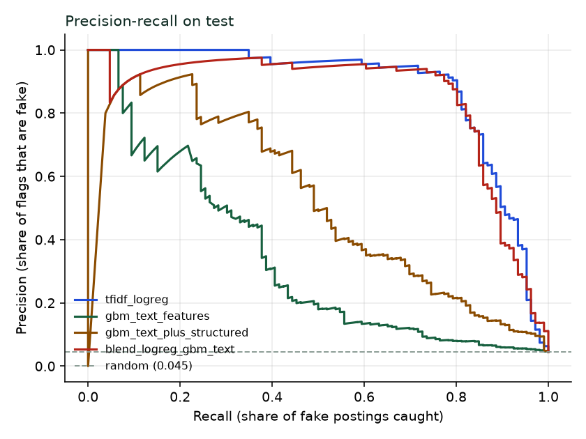
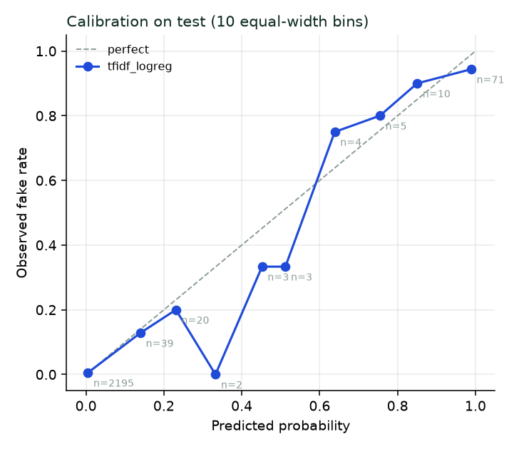
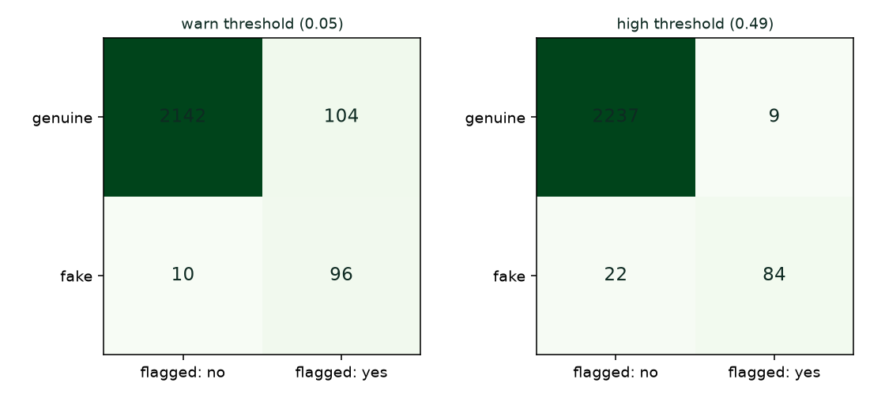
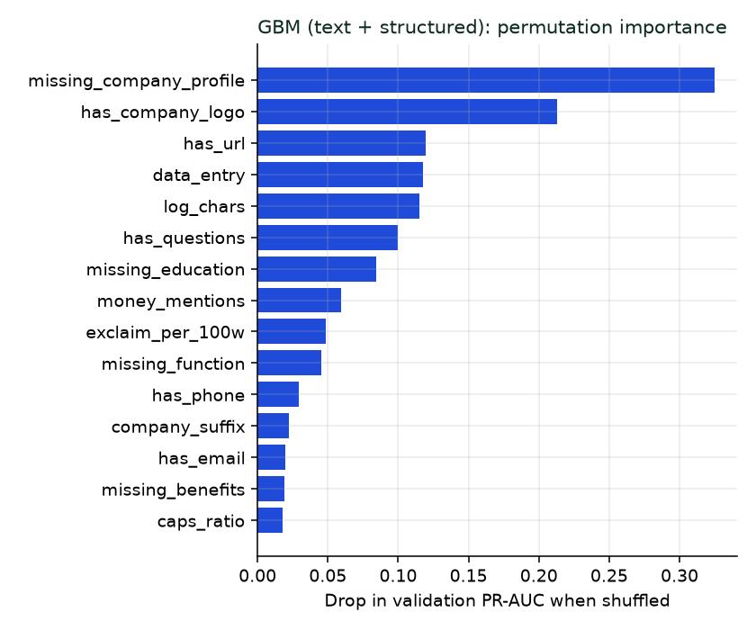

# Evaluation

Generated from `models/metrics.json` by `python -m legitcheck.model.evaluation_report`.

## Data and split

- 17,880 postings; 2,200 exact duplicates removed before splitting, leaving 15,680 (4.5% fake). 0 duplicate groups had conflicting labels and were marked fake.
- Stratified split (seed 42): train 10,976 / validation 2,352 / test 2,352; fake postings 493 / 106 / 106.
- Dataset SHA-256 `59253295129d8b6a...`, test-id fingerprint `4a74d6de91843dc1`.

## Validation (used to choose the model and the thresholds)

| Model | PR-AUC | Recall @ 90% precision | ROC-AUC | Brier |
|---|---|---|---|---|
| TF-IDF + logistic regression (served) | 0.878 | 0.717 | 0.984 | 0.0125 |
| Gradient boosting, text features | 0.339 | 0.123 | 0.780 | 0.0393 |
| Gradient boosting, text + structured (not servable) | 0.567 | 0.113 | 0.924 | 0.0307 |
| Average of LR and text GBM | 0.863 | 0.726 | 0.975 | 0.0191 |

Chosen for serving: **TF-IDF + logistic regression (served)**, the best validation PR-AUC among models that can run on pasted text. Thresholds: high: precision>=0.9 on val; warn: recall>=0.9 on val.

## Test (evaluated once)

| Model | PR-AUC | Recall @ 90% precision | ROC-AUC | Brier |
|---|---|---|---|---|
| TF-IDF + logistic regression (served) | 0.879 | 0.802 | 0.975 | 0.0116 |
| Gradient boosting, text features | 0.337 | 0.066 | 0.787 | 0.0392 |
| Gradient boosting, text + structured (not servable) | 0.525 | 0.226 | 0.914 | 0.0342 |
| Average of LR and text GBM | 0.850 | 0.783 | 0.980 | 0.0179 |

Baselines: predicting 'genuine' for everything is 95.5% accurate and useless; a random score has PR-AUC 0.045.

### Served model at the validation thresholds

| Threshold | Score cut-off | Precision | Recall | Caught | Missed | False alarms |
|---|---|---|---|---|---|---|
| warn | 0.046 | 0.480 | 0.906 | 96 | 10 | 104 of 2246 genuine |
| high | 0.485 | 0.903 | 0.792 | 84 | 22 | 9 of 2246 genuine |

 

## SYNTHETIC India set (separate, never trained on)

Written for this project with fictional companies. *dev* examples were used while writing the rules; *holdout* examples were written afterwards and only scored. 'Model alone' uses the warning threshold at every length.

Current verdict logic:

| Split | Messages | Model alone | Rules alone | Combined verdict |
|---|---|---|---|---|
| dev | scams flagged | 20/24 | 24/24 | 24/24 |
| dev | genuine flagged | 12/16 | 0/16 | 0/16 |
| holdout | scams flagged | 7/14 | 13/14 | 13/14 |
| holdout | genuine flagged | 7/10 | 0/10 | 0/10 |

First version, before the short-message rule:

| Split | Messages | Model alone | Rules alone | Combined verdict |
|---|---|---|---|---|
| dev | scams flagged | 20/24 | 24/24 | 24/24 |
| dev | genuine flagged | 12/16 | 0/16 | 12/16 |
| holdout | scams flagged | 7/14 | 13/14 | 14/14 |
| holdout | genuine flagged | 7/10 | 0/10 | 7/10 |

## Gradient boosting: which engineered features matter

